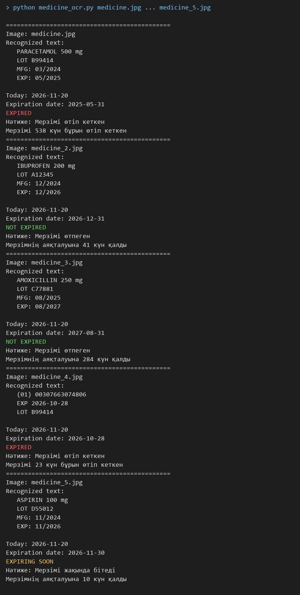

# Lab 12 — Дәрінің жарамдылық мерзімін анықтау (EasyOCR)

## Файлдар
| Файл | Не істейді |
|---|---|
| `medicine_ocr.py` | Негізгі бағдарлама: суреттен мәтін оқиды, мерзімді табады, бүгінмен салыстырады |
| `app.py` | Streamlit веб-интерфейсі (сурет жүктеу) — Advanced тапсырма |
| `make_test_images.py` | Тест суреттерін жасайды (`EXP: 05/2025`, `12/2026`, `08/2027`) |
| `medicine.jpg`, `medicine_2.jpg`, `medicine_3.jpg` | Тест суреттері |

## Орнату
```
pip install easyocr streamlit
```

## Іске қосу
```
python medicine_ocr.py
python medicine_ocr.py medicine.jpg medicine_2.jpg medicine_3.jpg
streamlit run app.py
```

## Орындалған тапсырмалар
- Негізгі: EasyOCR → EXP күнін табу → бүгінмен салыстыру → `EXPIRED` / `NOT EXPIRED`.
- MM/YYYY форматында мерзім — айдың соңғы күніне дейін деп есептеледі (`calendar.monthrange`).
- Easy: үш түрлі дәрінің суретін тексеру (бірнеше файл беруге болады).
- Easy: нәтиже қазақ тілінде де шығады («Мерзімі өтіп кеткен» / «Мерзімі өтпеген»).
- Medium: мерзімнің аяқталуына қанша күн қалғаны есептеледі.
- Medium: 30 күн немесе аз қалса — `EXPIRING SOON`.
- Advanced: Streamlit веб-интерфейсі (`app.py`).
- Қосымша жақсарту: күн `EXP` сөзінен кейін ізделеді, сондықтан өндірілген күнмен (`MFG`) шатастырмайды; `2026-10-28` (YYYY-MM-DD) форматын да таниды.

## Жобаны түсіндіру (қысқаша)
1. `easyocr.Reader(['en'], gpu=False)` — ағылшын мәтінін тану моделін жүктейді.
2. `reader.readtext(path, detail=0)` — суреттегі мәтін жолдарын тізім ретінде қайтарады.
3. Регулярлы өрнек (`re`) `MM/YYYY` немесе `YYYY-MM-DD` күнін іздейді.
4. Мерзім `date` объектісіне айналады, `date.today()`-пен салыстырылады.
5. `today > expiry` болса — EXPIRED, 30 күннен аз қалса — EXPIRING SOON, әйтпесе — NOT EXPIRED.

## Нәтиже (2026-11-20)


## Әзірлеушілер
- Кизат Хамза
- Арулан
